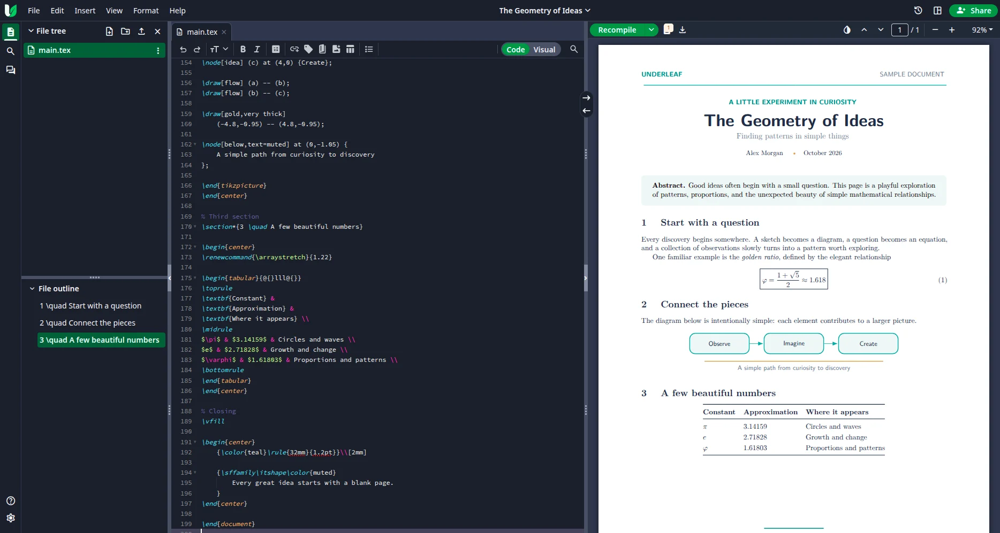
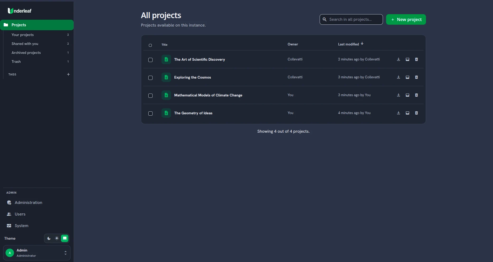
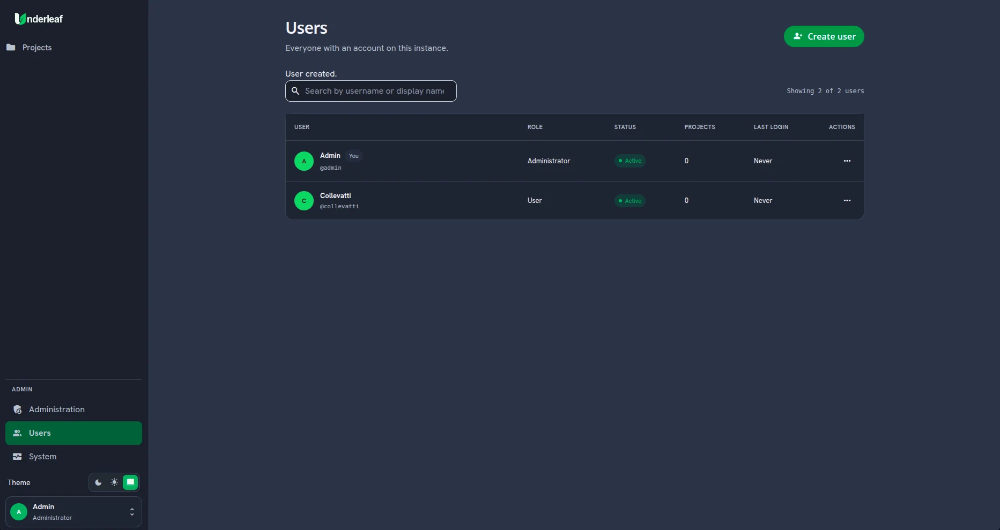

<div align="center">
  <picture>
    <source media="(prefers-color-scheme: dark)" srcset="docs/assets/underleaf-lockup-dark.svg">
    
  </picture>

  <h3>Collaborative LaTeX, on your infrastructure.</h3>

  <p>A self-hosted LaTeX editor built for teams who want control over their projects, accounts, and compilation environment.</p>

  <p>
    <a href="LICENSE"></a>
    
    
    
  </p>

  <p>
    <a href="#quick-start">Quick start</a> ·
    <a href="#features">Features</a> ·
    <a href="#configuration">Configuration</a> ·
    <a href="#documentation">Documentation</a>
  </p>
</div>

<p align="center">
  
</p>

Underleaf is an **open-source, self-hosted collaborative LaTeX editor** derived from [Overleaf Community Edition](https://github.com/overleaf/overleaf). It focuses on operator-managed installations, username-based accounts, and a separate **full TeX Live** compilation service. The upstream project's commercial and SaaS workflows have been removed; its origin and required attribution are preserved.

> [!NOTE]
> **Active beta.** Underleaf is intended for trusted local networks or VPN-backed access. It is not presented as a hardened, directly Internet-exposed service.

## Why Underleaf?

- **Your infrastructure, your data.** Run the stack with Docker Compose and keep projects and application data in persistent Docker volumes.
- **Full TeX Live.** Compile with pdfLaTeX, XeLaTeX, or LuaLaTeX, with BibTeX/Biber support and a broad package collection.
- **Straightforward administration.** Set up the first administrator, provision users, and manage access without public registration.
- **Separated compilation.** The LaTeX compiler runs in its own container, isolated from application secrets and the MongoDB/Redis network.

## Features

- Browser-based LaTeX source editing, multi-file projects, and side-by-side PDF preview.
- Real-time collaboration, project sharing, history, and per-user permissions.
- Username-based accounts, administrator-managed user lifecycle, and no public sign-up.
- **System**, **Light**, and **Dark** appearance options.
- Local backups, persistent data volumes, and operator-facing health commands.

### A look inside

<table>
  <tr>
    <td width="50%" align="center"><strong>Project dashboard</strong></td>
    <td width="50%" align="center"><strong>User management</strong></td>
  </tr>
  <tr>
    <td></td>
    <td></td>
  </tr>
</table>

## Quick start

**Requirements:** Docker Engine or Docker Desktop with **Compose v2**, Git, an `x86_64/amd64` system, at least **8 GB of available RAM during the initial build**, and **30 GB of free disk space** (plus space for projects and backups). Linux and Windows with Docker Desktop in Linux containers mode are the supported targets; **ARM64 and macOS are not officially supported** in this release.

**Linux**

```bash
git clone https://github.com/LucasCollevatti/underleaf.git
cd underleaf
bash ./scripts/underleaf.sh up
```

**Windows (PowerShell)**

With Docker Desktop running Linux containers (WSL2 integration recommended):

```powershell
git clone https://github.com/LucasCollevatti/underleaf.git
Set-Location underleaf
powershell -NoProfile -ExecutionPolicy Bypass -File .\scripts\underleaf.ps1 up
```

The setup helpers generate a local `.env` with a persistent session secret, build the images, and start the services. **The initial build can take time and download large images**, primarily because Underleaf includes full TeX Live inside its compiler image. You do **not** need TeX Live, Node.js, Yarn, or Make installed on the host.

Once the services are ready, open **[http://localhost:8080](http://localhost:8080)**, select **Set up Underleaf** on the welcome screen, and create your first administrator. There are **no default credentials**. Further accounts are provisioned at `/admin/users`.

For detailed steps and Windows troubleshooting, see the [installation guide](docs/INSTALLATION.md).

## Configuration

The default local deployment uses HTTP on port **8080**. To change the port or set the address users should visit, edit the generated `.env` before starting or restarting the stack:

```dotenv
UNDERLEAF_HTTP_PORT=8080
UNDERLEAF_SITE_URL=http://localhost:8080
```

For example, on a **trusted LAN**, set `UNDERLEAF_SITE_URL` to your server's reachable IP address and port. If you change the port, keep both values consistent and make sure the host firewall allows access only from trusted devices.

**Do not expose the default HTTP service directly to the public Internet.** An optional Caddy/HTTPS overlay is documented, but setting up a reverse proxy does not by itself provide production security hardening. See [Installation](docs/INSTALLATION.md), [Deployment](docs/DEPLOYMENT.md), and [Security](docs/SECURITY.md).

## Everyday operations

| Task | Linux | Windows PowerShell |
| --- | --- | --- |
| Start / rebuild | `bash ./scripts/underleaf.sh up` | `.\scripts\underleaf.ps1 up` |
| Health check | `bash ./scripts/underleaf.sh health` | `.\scripts\underleaf.ps1 health` |
| View logs | `bash ./scripts/underleaf.sh logs` | `.\scripts\underleaf.ps1 logs` |
| Stop (keep data) | `bash ./scripts/underleaf.sh down` | `.\scripts\underleaf.ps1 down` |
| Back up | `bash ./scripts/underleaf.sh backup` | `.\scripts\underleaf.ps1 backup` |
| Rebuild compiler | `bash ./scripts/underleaf.sh build-compiler` | `.\scripts\underleaf.ps1 build-compiler` |

**Before upgrades**, create a backup and follow the [upgrade procedure](docs/UPGRADING.md). Stopping the stack with `down` preserves the named volumes.

## Architecture

Underleaf runs as a small Docker Compose stack with these main services:

| Service | Purpose |
| --- | --- |
| `app` | Web interface, authentication, and application services |
| `compiler` | Isolated LaTeX compilation service with full TeX Live |
| `mongo` | Users, projects, and metadata |
| `redis` | Sessions, queues, and real-time collaboration |

The compiler publishes no host ports and does not receive app secrets or access the MongoDB/Redis backend network. Read the [architecture overview](docs/ARCHITECTURE.md) for details.

## Documentation

| Topic | Guide |
| --- | --- |
| Installation and access | [Installation](docs/INSTALLATION.md) · [Deployment](docs/DEPLOYMENT.md) |
| LaTeX engines and packages | [Full TeX Live](docs/TEXLIVE.md) |
| Operations | [Backup](docs/BACKUP.md) · [Persistence](docs/PERSISTENCE.md) · [Upgrading](docs/UPGRADING.md) |
| Support and diagnostics | [Troubleshooting](docs/TROUBLESHOOTING.md) · [Observability](docs/OBSERVABILITY.md) |
| Project internals | [Architecture](docs/ARCHITECTURE.md) · [Development](docs/DEVELOPMENT.md) |
| Security and provenance | [Security](docs/SECURITY.md) · [Project origin](docs/ORIGIN.md) |

## Contributing

Issues and contributions are welcome. Read [CONTRIBUTING.md](CONTRIBUTING.md) and the [development guide](docs/DEVELOPMENT.md) before submitting changes. Please sanitize logs and never commit credentials, `.env` files, backups, or private documents. Report vulnerabilities through the [private disclosure policy](.github/SECURITY.md).

## License and attribution

Underleaf is licensed under **[AGPL-3.0](LICENSE)**. It is derived from Overleaf Community Edition; upstream provenance, original license notices, and third-party acknowledgments are documented in [ORIGIN.md](docs/ORIGIN.md) and [THIRD_PARTY_NOTICES.md](THIRD_PARTY_NOTICES.md).
